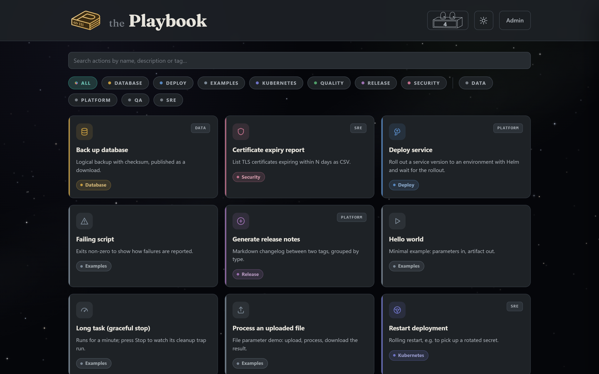
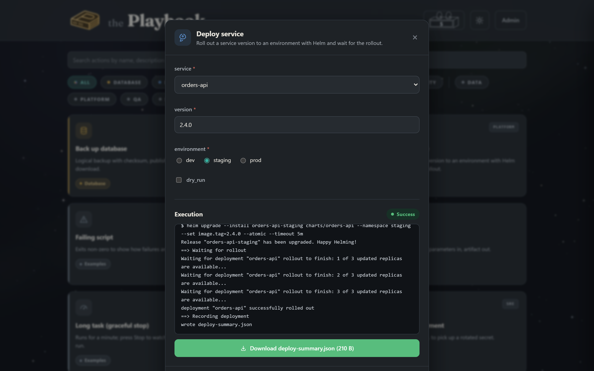
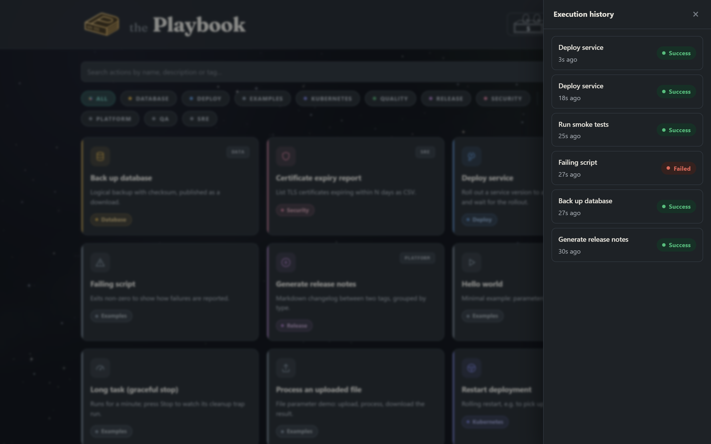
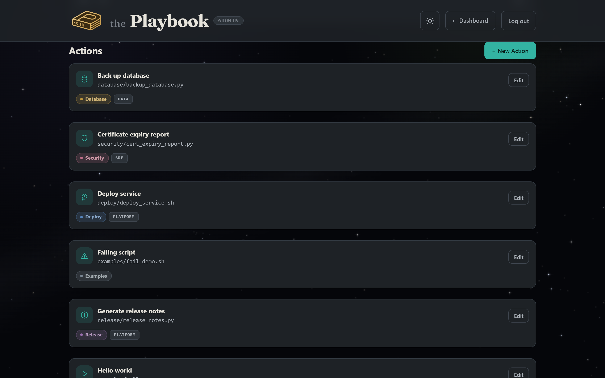
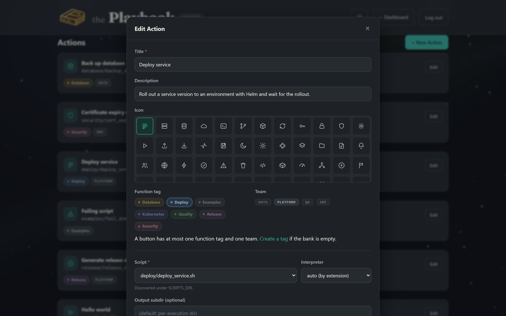
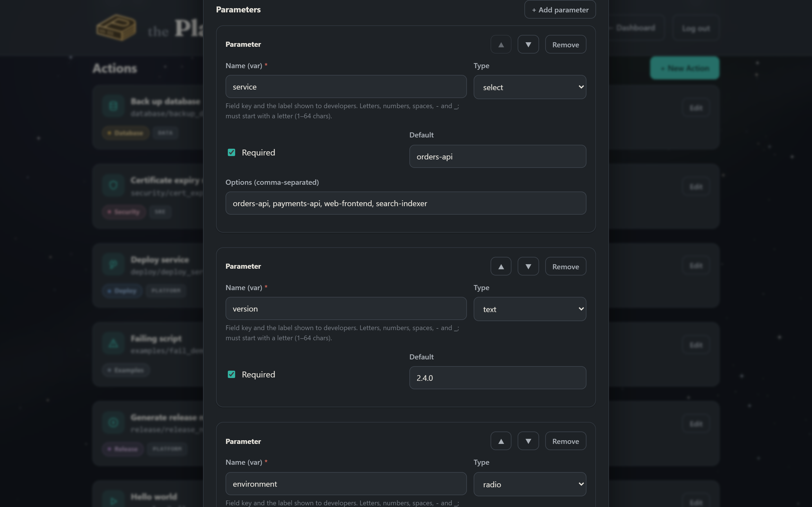
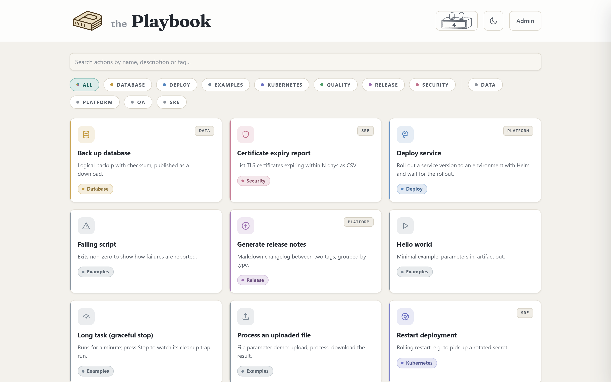
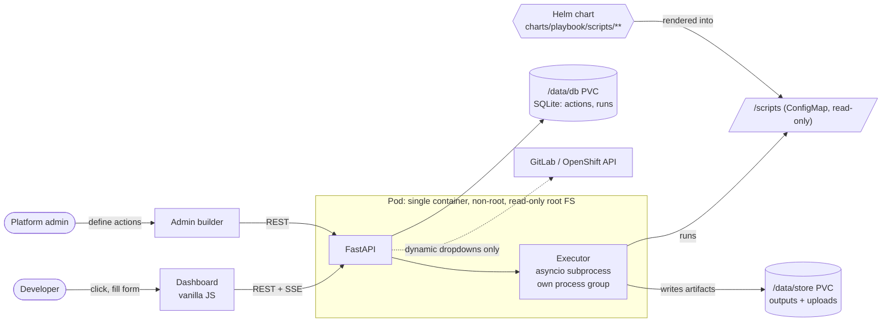

# the Playbook

**A self-service developer portal that turns operator-owned scripts into one-click, parameterised actions, shipped as a hardened Helm chart for Kubernetes and OpenShift.**

[](https://github.com/amir-haskel/devops-dashboard/actions/workflows/ci.yaml)


Platform teams write the automation (deploys, rollbacks, restarts, backups, reports) once, as plain scripts.
Developers run it from a dashboard: pick an action, fill in a form, watch the logs stream live and download what
the script produced. Nobody needs cluster credentials or a CLI, and every run is recorded.



## Contents

- [Features](#features)
- [Screenshots](#screenshots)
- [How it works](#how-it-works)
- [Deploying with Helm](#deploying-with-helm)
- [Writing scripts](#writing-scripts)
- [Local development](#local-development)
- [CI/CD](#cicd)
- [Configuration](#configuration)
- [API](#api)
- [Security model](#security-model)
- [Repository layout](#repository-layout)

## Features

- **Script-backed actions.** Each card runs one script from the scripts folder. Paths are confined to that folder, so an action can only run what operators shipped.
- **Dynamic forms.** Text, number, checkbox, radio, select, file upload, and dropdowns filled live from the GitLab or OpenShift APIs. Values reach the script as positional args **and** env vars.
- **Live logs over SSE.** stdout/stderr stream to the browser line by line. You can close the window and re-attach later, and output survives a pod restart.
- **Artifacts.** Anything the script writes to `$OUTPUTS_DIR` becomes a download button.
- **Graceful stop.** Stop sends `SIGTERM` to the script's whole process group, so cleanup traps run, then `SIGKILL` after 10 s.
- **History.** Every run is kept with its status, log and artifacts; retention is configurable in Admin.
- **Admin builder.** Create actions, parameters, tags (function and team) and icons in the UI. No YAML to edit.
- **Air-gap friendly.** No CDNs, web fonts or npm: the frontend is vanilla JS with bundled SVG icons and a self-hosted font.
- **Light and dark themes**, and re-brandable through two env vars.

## Screenshots

| Run an action: live log, status and artifact | Execution history |
|---|---|
|  |  |

| Admin: action catalog | Admin: action editor |
|---|---|
|  |  |

| Admin: parameter builder | Light theme |
|---|---|
|  |  |

## How it works



1. **Operators** commit scripts to [`charts/playbook/scripts/`](charts/playbook/scripts/). On `helm upgrade` the chart renders them into a ConfigMap that is mounted read-only at `/scripts` with the folder structure intact.
2. **Admins** use `/admin` to turn a script into an action: title, icon, tags, and a typed parameter form.
3. **Developers** run the action. The backend validates the input, launches the script in its own process group with the values as `$1 $2 …` and env vars, and streams the output over Server-Sent Events.
4. When the script exits, the files in its output directory are registered as artifacts, and the run is stored in SQLite with its status and log.

The app process is stateless apart from two volumes: the SQLite database and the execution store. That is why the
chart pins one replica with the `Recreate` strategy.

## Deploying with Helm

The chart in [`charts/playbook`](charts/playbook) is the supported way to run the Playbook. Full reference: [chart README](charts/playbook/README.md).

```bash
# Kubernetes
helm upgrade --install playbook ./charts/playbook -n playbook --create-namespace \
  --set ingress.enabled=true --set ingress.hosts[0].host=playbook.example.com \
  --set ingress.hosts[0].paths[0].path=/ --set ingress.hosts[0].paths[0].pathType=Prefix

# OpenShift
helm upgrade --install playbook ./charts/playbook -n playbook --create-namespace \
  --set route.enabled=true

# Admin password (generated on first install, stable across upgrades)
kubectl get secret playbook-secrets -n playbook -o jsonpath='{.data.ADMIN_PASSWORD}' | base64 -d
helm test playbook -n playbook
```

Highlights of the chart:

- **Scripts as a ConfigMap.** Every file under `scripts/` is embedded with `.Files.Glob`. Nested paths are flattened into valid keys and restored through volume `items`. The render fails on bad names, key collisions, or more than 1 MiB of scripts. Edits to existing scripts are hot-reloaded without restarting the pod.
- **Two PVCs**, one for the database and one for outputs, each with `helm.sh/resource-policy: keep`.
- **Secrets** are generated once and preserved with `lookup`, or supplied via `auth.existingSecret` (External Secrets, Sealed Secrets, Vault).
- **Restricted Pod Security**: non-root, read-only root filesystem, all capabilities dropped, seccomp `RuntimeDefault`, SA token not mounted, service links disabled.
- **OpenShift-aware**: the chart detects OpenShift and lets the `restricted-v2` SCC assign the UID. Optional Route with a 1h timeout for long log streams.
- `values.schema.json`, startup/readiness/liveness probes, an optional NetworkPolicy, a `helm test` hook, and chart-testing values in `ci/`.

## Writing scripts

Drop a file into `charts/playbook/scripts/<folder>/` and deploy. Every script can rely on the following:

| | |
|---|---|
| Parameters | Positional args in form order (`$1 $2 …`), plus an env var per parameter |
| Output files | Write to `$OUTPUTS_DIR` (also the working directory) and they become downloads |
| Uploaded files | Arrive as a filename in the working directory |
| Run id | `$PLAYBOOK_EXECUTION_ID` |
| Result | Exit `0` = SUCCESS, anything else = FAILED |
| Stop button | `SIGTERM` to the process group; trap it to clean up |

```bash
#!/usr/bin/env bash
# charts/playbook/scripts/kubernetes/restart_deployment.sh
set -euo pipefail
namespace="${1:?namespace is required}"
deployment="${2:?deployment is required}"
oc rollout restart "deployment/${deployment}" -n "${namespace}"
oc rollout status  "deployment/${deployment}" -n "${namespace}" --timeout=5m
```

The bundled scripts under `deploy/`, `kubernetes/`, `database/`, `quality/`, `security/` and `release/` are demos with
simulated output, so the chart works on any cluster. `examples/` covers each platform feature: file params,
graceful stop and failure reporting.

## Local development

```bash
pip install -r requirements.txt
make run                     # ADMIN_PASSWORD=changeme, scripts read straight from the chart folder
make seed                    # in a second terminal: load the demo catalog and run a few actions
```

Open <http://localhost:8000> and sign in to `/admin` with `changeme`. On Windows without `make`:

```powershell
$env:ADMIN_PASSWORD = "changeme"; python -m uvicorn app.main:app --reload
```

Other targets: `make test`, `make lint`, `make image`, `make chart-lint`, `make install` (current kube context) and
`make screenshots` (regenerates the images in this README with Playwright).

## CI/CD

| Workflow | What it does |
|---|---|
| [`ci.yaml`](.github/workflows/ci.yaml) | Ruff, shellcheck and pytest · `helm lint --strict` for every CI values file · kubeconform on the rendered default, hardened and OpenShift manifests · Docker build + Trivy scan, pushed to GHCR from `main` · **end-to-end on kind**: install with `restricted` Pod Security enforced, `helm test`, check the mounted script tree, run real actions through the API, and confirm generated secrets survive `helm upgrade` |
| [`release.yaml`](.github/workflows/release.yaml) | On a `v*.*.*` tag: multi-arch image with SBOM and provenance, chart packaged and pushed to `oci://ghcr.io/<owner>/charts`, GitHub release |
| [`dependabot.yml`](.github/dependabot.yml) | Weekly updates for pip, the base image and GitHub Actions |

## Configuration

Environment variables (the chart sets them from values):

| Variable | Purpose | Local default |
|---|---|---|
| `ADMIN_PASSWORD` | Admin login (required for `/admin`) | (none) |
| `SESSION_SECRET` | Session-cookie signing key | random per boot |
| `SCRIPTS_DIR` | Script root | `./charts/playbook/scripts` |
| `DATA_DIR` | Base for the two dirs below | `./data` |
| `DB_DIR` / `STORE_DIR` | SQLite volume / outputs + uploads volume | `$DATA_DIR/db`, `$DATA_DIR/store` |
| `BRAND_ARTICLE` / `BRAND_NAME` | Header wordmark | `the` / `Playbook` |
| `GITLAB_API_URL` / `GITLAB_TOKEN` | Dynamic dropdown source | (none) |
| `OPENSHIFT_API_URL` / `OPENSHIFT_TOKEN` | Dynamic dropdown source | (none) |
| `HTTP_TIMEOUT` | Dropdown fetch timeout (s) | `15` |

Dropdown auth headers can reference any env var, e.g. `PRIVATE-TOKEN: ${NEXUS_TOKEN}`. The value is substituted
on the server and never reaches the browser. Add such variables with the chart's `extraEnvFrom`.

## API

| Endpoint | Method | Notes |
|---|---|---|
| `/api/v1/actions` | GET · POST | List (public, secrets stripped) · create (admin) |
| `/api/v1/actions/{id}` | GET · PUT · DELETE | Admin for writes |
| `/api/v1/tags` · `/api/v1/tags/{id}` | GET · POST · PUT · DELETE | Tag bank |
| `/api/v1/execute/{action_id}` | POST | Start a run → `execution_id` |
| `/api/v1/stream/{execution_id}` | GET | SSE log stream + terminal status event (replayable) |
| `/api/v1/executions` · `/executions/stats` | GET | History · success counter |
| `/api/v1/executions/{id}/stop` | POST | Graceful stop |
| `/api/v1/upload` | POST | Stage a file parameter |
| `/api/v1/download/{file_id}` | GET | Download an artifact (path-confined) |
| `/api/v1/dynamic-options/{type}` · `/test` | GET · POST | Live dropdown fetch · admin dry-run |
| `/api/v1/settings` | GET · PUT | History retention |
| `/api/v1/admin/login` · `/logout` · `/session` · `/scripts` | POST · GET | Session auth, script discovery |
| `/healthz` | GET | Probe endpoint |

Interactive OpenAPI docs are served at `/docs`.

## Security model

Running admin-configured scripts is the product, so the controls are about limiting who can change what runs and
what it can reach:

- Only admins can create or change actions (signed session cookie, constant-time password check).
- Scripts come from a **read-only** ConfigMap. Script paths are resolved inside `SCRIPTS_DIR`, and traversal or absolute paths are rejected. Downloads are confined to the outputs directory.
- Integration tokens are injected on the server; the browser never sees them.
- The pod runs with the restricted profile described above and, by default, without a Kubernetes API token. Grant API access deliberately with `serviceAccount.automount` plus your own RBAC.
- Deploy it on a trusted internal network, behind your SSO-aware ingress if you have one.

## Repository layout

```
app/                 FastAPI backend (routers, executor, SQLite store)
static/              Dashboard + admin UI (vanilla JS/CSS, no build step)
charts/playbook/     Helm chart
  scripts/           The scripts behind the buttons, shipped as a ConfigMap
  templates/         Deployment, PVCs, Secret, ConfigMap, Service, Route, Ingress, NetworkPolicy, tests
  ci/                chart-testing values
hack/                seed_demo.py (demo catalog), screenshots.py (README images)
tests/               Unit tests
docs/images/         Screenshots
.github/workflows/   CI and release pipelines
```
